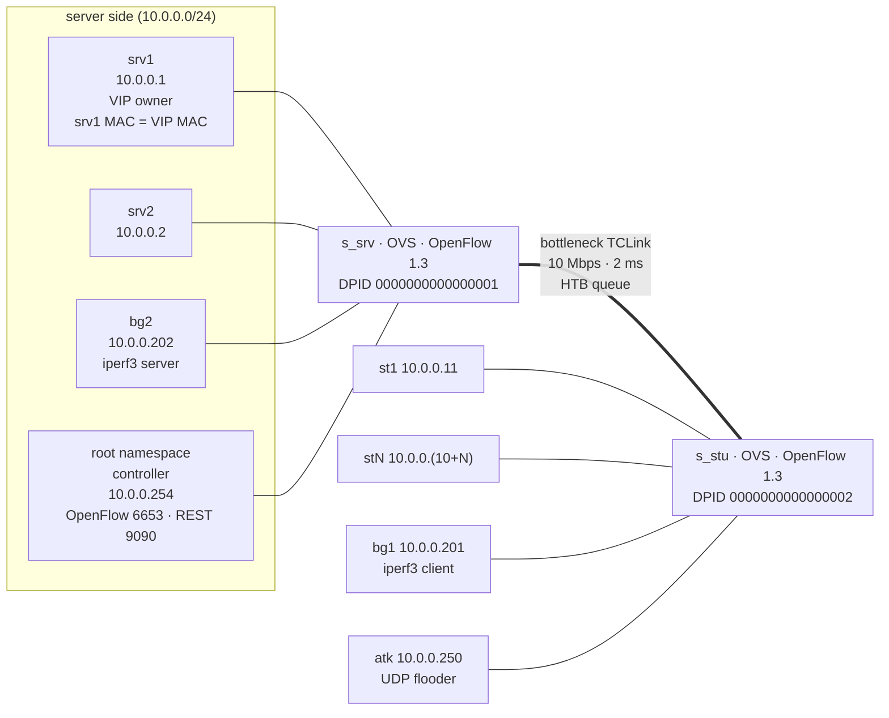

# Exam SDN design (Mininet + Open vSwitch + os-ken)

This document describes the SDN half of the online-exam project. The C exam
server, its SQLite database, and the stdlib exam clients are unchanged; the SDN
layer adds a reproducible Mininet topology, an OpenFlow 1.3 controller with two
operating modes, and an automated acceptance demo.

The design deliberately keeps every exam-facing client on the Python standard
library:

* the topology and scripts use only Mininet/os-ken plus the Python stdlib;
* latency probes and the flood generator use `socket` directly;
* the C server notifier is a hand-written HTTP/1.1 client over raw sockets;
* Nginx is **not** part of the Mininet path.

## 1. Topology



Facts that matter for the controller:

| Item | Value |
| --- | --- |
| Exam subnet | `10.0.0.0/24` |
| Servers | `srv1=10.0.0.1`, `srv2=10.0.0.2` |
| VIP | `10.0.0.100` |
| Students | `10.0.0.(10+i)` for `i=1..N`, `N<=50` |
| Background | `bg1=10.0.0.201` (student side), `bg2=10.0.0.202` (server side) |
| Attacker | `10.0.0.250` |
| Controller | `10.0.0.254`, OpenFlow `6653`, REST `9090` |
| Student MACs | `00:00:00:00:10:01` … `00:00:00:00:10:32` |
| VIP MAC | `00:00:00:00:00:01` (same as `srv1`) |
| Bottleneck | `10 Mbps`, `2 ms`, configurable with `--bw` |
| OVS mode | OpenFlow 1.3, `failMode=secure`, kernel datapath |

`bg2` is intentionally on the server side. An `iperf3` flow from `bg1` to
`bg2` must cross the student↔server bottleneck, so it competes with exam
traffic exactly where the SDN policy is applied.

The controller runs in the root network namespace and is connected to `s_srv`
by a veth. The topology adds `10.0.0.254/32` to that interface and a
`10.0.0.0/24` route, so controller health probes and backend heartbeats never
cross the student bottleneck. Mininet 2.3.0 does not export
`mininet.util.connectToRootNS`, so `sdn/topology.py` implements the veth/root
pattern locally.

### Topology metadata

After the network is built, the topology writes `run/topology.json`. The
controller retries loading it, so it may start before the topology. The file
contains:

* `switches`: DPID, host ports, bottleneck port, and metadata for each OVS;
* `servers` / `clients`: name, IP, MAC, switch, port, role and side;
* `root`: IP, MAC, switch and port of the controller veth;
* `vip` / `vip_mac`;
* `bottleneck`: bandwidth, delay, interface names and OVS port numbers;
* `students_map`, `background`, and `attacker` convenience records.

The controller maps ports from this file rather than assuming OVS port order.

## 2. Operating modes

`POST /sdn/mode` switches modes at runtime. A mode switch deletes controller
installed flows, reinstalls the table-miss rule, clears blocks, and rebuilds the
mode-specific baseline.

### `static`

* Plain learning switch using OpenFlow 1.3.
* No meters, queues, or QoS classification.
* No flow/port polling, abuse blocking, health probes, or VIP rewrites.
* `srv1` owns `10.0.0.100/32` on `lo`; every client has a static ARP entry
  mapping the VIP to `srv1`'s MAC. The VIP therefore works as ordinary L2
  traffic to `srv1`.

This is the baseline used by the latency comparison.

### `sdn`

* Event-driven exam prioritization.
* Two-second flow, port, and meter statistics.
* Per-host ingress-rate abuse detection and timed blocking.
* Backend health probes and VIP failover with flow rewrites.

The table-miss rule always sends unknown packets to the controller. The
controller learns from packet-in messages and installs unicast flows.

## 3. OpenFlow rule layout

All controller rules are in the single OpenFlow 1.3 table. Grouping uses
cookies so a logical set of rules can be deleted with one flow-mod.

| Priority | Cookie | Purpose |
| --- | --- | --- |
| 500 | `COOKIE_BLOCK` | Drop all traffic from a blocked host or port |
| 400 | `COOKIE_VIP_FLOW` | Per-flow VIP DNAT/SNAT rewrites |
| 350 | `COOKIE_VIP_MISS` | Send new packets destined to the VIP to the controller |
| 250 | monitor | Reserved for an optional monitoring flow (not installed by default) |
| 200 | `COOKIE_EXAM` | Exam-class learning flows (meter/queue) |
| 100 | `COOKIE_BACKGROUND` | Non-exam learning flows (meter/queue) |
| 10 | `COOKIE_LEARNING` | Static-mode learning flows |
| 0 | `COOKIE_TABLE_MISS` | Send unknown packets to the controller |

`PRIORITY_BLOCK` is higher than the VIP rules, so blocking a host also stops
its VIP traffic. The VIP miss rule is installed on both switches; per-flow
rules are installed on both the client and server switches when the endpoints
are on different sides of the bottleneck.

### VIP flow rewriting

The client keeps a single static ARP entry: `10.0.0.100 -> srv1 MAC`. On the
client switch a new VIP flow matches the original five-tuple and applies:

* `set eth_dst = backend MAC`
* `set ipv4_dst = backend IP`

The server switch matches the rewritten `ipv4_dst` and forwards to the backend
port. The return path rewrites:

* `set eth_src = VIP MAC`
* `set ipv4_src = 10.0.0.100`

so the client sees the same VIP address and MAC before and after failover.

This design means existing connections to `srv1` are not migrated; failover
affects **new** VIP flows, which is the required demo behavior. The controller
deletes all `COOKIE_VIP_FLOW` rules at failover, so new packets re-enter the VIP
miss path and are rewritten to the healthy backend.

## 4. Exam QoS

An exam becomes active when the C server (or the demo) posts any of:

* `exam_started` / `exam_start`;
* `attempt_started` with a positive `active_attempts`;
* a heartbeat or health response reporting positive active attempts.

`exam_ended`, `exam_end`, `exam_closed`, or zero attempts with no lifecycle
flag turn QoS off.

The controller starts with `qos_backend=auto`:

1. Query `OFPMeterFeaturesStatsRequest`.
2. If drop meters are supported, install:
   * meter 1: exam class, default `8 Mbps`;
   * meter 2: background class, default `2 Mbps`.
3. Otherwise try the OVS HTB queue fallback (`ovs-vsctl`).
4. If neither is available, fall back to priority-only classification and
   record `backend=priority` in `/sdn/state`.

Classification is intentionally broad:

* any flow to or from the VIP is exam traffic;
* flows to/from an exam server on port `8080` are exam traffic;
* ICMP to/from an exam server is exam monitoring traffic;
* everything else is background.

Exam learning flows use priority 200; background flows use priority 100. With
meters, every flow of a class references the same meter, so the rate limit is
shared by the class. With queues, the flow carries `OFPAT_SET_QUEUE`. With the
priority-only fallback the class survives only as flow priority, and the demo
will report a benchmark warning instead of a latency improvement.

The demo keeps the static and SDN benchmark phases independent, so a completed
attempt is never reused between them.

## 5. Monitoring and abuse blocking

The monitor thread runs every `EXAM_SDN_MONITOR_INTERVAL` seconds (default
`2.0`) while the mode is `sdn`:

* `OFPFlowStatsRequest` for per-cookie flow/packet/byte totals;
* `OFPPortStatsRequest` for per-port rates;
* `OFPMeterStatsRequest` when meters are active.

Host rates are computed from successive port counters. A non-server host is
blocked when either threshold is crossed:

* `rx_bytes_per_sec >= 2_000_000` (2 MB/s), or
* `rx_packets_per_sec >= 5_000`.

Blocking installs a priority-500 drop flow matching the host's switch port
(falling back to `eth_src` when the port is unknown) with a hard timeout. The
block is also tracked in controller state and removed explicitly when it
expires. The default timeout is 20 seconds; the demo uses 10 seconds so the
unblock check stays short.

## 6. Health checks and VIP failover

The controller probes each exam server with a raw-socket `GET /health` every
`EXAM_SDN_HEALTH_INTERVAL` seconds (default 2). A failed probe increments a
consecutive-failure counter; after `EXAM_SDN_HEALTH_FAILURES` failures (default
2) the backend is marked unhealthy.

If the active VIP backend is unhealthy, the controller selects the first
healthy server in name order (`srv1`, then `srv2`), records `vip_failover` in
the decision log, deletes all VIP per-flow rules, and lets new packets be
rewritten to the new backend. `srv1` remains the owner of the VIP address on
loopback, but `srv2` accepts VIP traffic because the controller rewrites the
destination IP to `10.0.0.2` before it reaches the server switch.

Health responses also update the active-attempt count from the server's
`/health` JSON, so the C server and controller do not need a second control
channel.

## 7. REST API

The controller uses Python's `ThreadingHTTPServer` inside the os-ken process.
Responses are JSON. Unknown routes return `404`; wrong methods return `405`;
invalid JSON or validation errors return `400`.

### `POST /exam/event`

```json
{
  "event": "attempt_started",
  "server": "10.0.0.1:8080",
  "exam_id": 7,
  "active_attempts": 1,
  "active_connections": 4,
  "ts": 1793638352
}
```

Accepted events: `exam_published`, `exam_started`, `exam_start`,
`attempt_started`, `attempt_submitted`, `exam_ended`, `exam_end`,
`exam_closed`, `server_status`.

Response:

```json
{
  "ok": true,
  "event": "attempt_started",
  "mode": "sdn",
  "exam_active": true,
  "exam_id": 7,
  "active_attempts": 1
}
```

### `GET /sdn/state`

Returns the live controller view. Important sections:

```json
{
  "mode": "sdn",
  "metadata": {"loaded": true, "path": ".../run/topology.json"},
  "switches": {
    "expected": ["s_srv", "s_stu"],
    "connected": [{"name": "s_srv", "dpid": "0000000000000001"}],
    "all_connected": true
  },
  "exam": {
    "active": true,
    "exam_id": 7,
    "active_attempts": 1,
    "event_counts": {"attempt_started": 1}
  },
  "qos": {
    "active": true,
    "backend": "meter",
    "exam_rate_mbps": 8.0,
    "background_rate_mbps": 2.0
  },
  "vip": {
    "ip": "10.0.0.100",
    "backend": "srv1",
    "backend_ip": "10.0.0.1",
    "failovers": 0
  },
  "servers": {
    "srv1": {"ip": "10.0.0.1", "healthy": true, "active_attempts": 1}
  },
  "monitoring": {"enabled": true, "interval_s": 2.0},
  "blocked_hosts": []
}
```

### `GET /sdn/stats`

Returns per-switch flow counts and categories, per-host port rates, meter
counters, total packets/bytes, packet-in count, and the current blocked-host
list. This is the endpoint used by the demo to prove monitoring is live.

### `POST /sdn/mode`

```json
{"mode": "sdn"}
```

Response:

```json
{"ok": true, "mode": "sdn", "changed": true, "exam_active": false}
```

### `GET /health`

```json
{"status": "ok", "service": "exam-sdn-controller", "mode": "sdn", "uptime_s": 12.3}
```

## 8. Configuration

`osken-manager` does not expose application-specific flags, so the controller
reads environment variables. `sdn/scripts/run_controller.sh` provides friendly
flags and sets them.

| Environment variable | Default | Meaning |
| --- | --- | --- |
| `EXAM_SDN_MODE` | `sdn` | starting mode |
| `EXAM_SDN_REST_HOST` | `0.0.0.0` | REST bind address |
| `EXAM_SDN_REST_PORT` | `9090` | REST port |
| `EXAM_SDN_METADATA` | `<repo>/run/topology.json` | topology metadata |
| `EXAM_SDN_LOG` | `<repo>/run/controller.ndjson` | JSONL decision log |
| `EXAM_SDN_MONITOR_INTERVAL` | `2.0` | stats polling interval (s) |
| `EXAM_SDN_BLOCK_SECONDS` | `20.0` | abuse block timeout (s) |
| `EXAM_SDN_ABUSE_BYTES_PER_SEC` | `2000000` | ingress byte-rate threshold |
| `EXAM_SDN_ABUSE_PACKETS_PER_SEC` | `5000` | ingress packet-rate threshold |
| `EXAM_SDN_PACKETIN_THRESHOLD` | `1500` | packet-in burst threshold |
| `EXAM_SDN_HEALTH_INTERVAL` | `2.0` | health probe interval (s) |
| `EXAM_SDN_HEALTH_TIMEOUT` | `0.5` | health probe timeout (s) |
| `EXAM_SDN_HEALTH_FAILURES` | `2` | failures before unhealthy |
| `EXAM_SDN_SERVER_PORT` | `8080` | exam server port |
| `EXAM_SDN_EXAM_RATE_MBPS` | `8.0` | exam meter rate |
| `EXAM_SDN_BACKGROUND_RATE_MBPS` | `2.0` | background meter rate |
| `EXAM_SDN_QOS_BACKEND` | `auto` | `auto`, `meter`, `queue`, or `priority` |
| `EXAM_SDN_QUEUE_CLEAR` | `1` | remove HTB qdiscs when QoS ends |

The decision log is newline-delimited JSON with wall-clock timestamps. It
records controller startup, REST events, mode changes, exam state transitions,
QoS backend choices, switch connections, meter installation/errors, VIP
failovers, blocks/unblocks, and scan summaries.

## 9. Running the demo

Create the controller runtime once:

```bash
python3 -m venv sdn/.venv
sdn/.venv/bin/pip install -r sdn/requirements.txt
bash sdn/scripts/check_env.sh
```

`check_env.sh` verifies Mininet, OVS, os-ken/eventlet, the C-server build
dependencies, `iperf3`, and (when run with passwordless sudo) a temporary OVS
meter test.

The automated demo must run as root because Mininet creates namespaces and
veth pairs:

```bash
sudo python3 sdn/scripts/demo.py --students 10
```

It performs:

1. controller startup (unless one is already healthy on the REST port);
2. topology build and metadata generation;
3. two stdlib stub backends on `srv1`/`srv2` and an `iperf3` server on `bg2`;
4. `pingall` in `static` mode;
5. static latency probe while `bg1 -> bg2` iperf runs;
6. `pingall` in `sdn` mode;
7. exam activation, QoS verification, and the SDN latency probe under the same
   iperf load;
8. UDP flood from `atk`, block detection, flood stop, and unblock after
   timeout;
9. `srv1` backend stop, VIP failover to `srv2`, and a probe that must be served
   by `srv2`;
10. state/stats/summary artifacts under `run/demo/`.

Artifacts:

* `run/demo/controller.log` and `controller.ndjson`;
* `run/demo/stub-srv1.ndjson`, `stub-srv2.ndjson`;
* `run/demo/probe-static.json`, `probe-sdn.json`, `probe-failover.json`;
* `run/demo/state.json`, `stats.json`, `summary.json`.

The demo exits non-zero if pingall, blocking, unblocking, or failover fails. A
latency result where SDN is not better than static is reported as a warning
(with `status: pass-with-benchmark-warning`) rather than hiding the rest of the
acceptance checks.

### Manual run

Terminal 1:

```bash
sdn/scripts/run_controller.sh --mode static
```

Terminal 2:

```bash
sudo sdn/scripts/run_topology.sh --students 10
```

Then switch modes and inject events with `curl`:

```bash
curl -s -X POST -H 'Content-Type: application/json' \
  -d '{"mode":"sdn"}' http://127.0.0.1:9090/sdn/mode
curl -s -X POST -H 'Content-Type: application/json' \
  -d '{"event":"exam_started","server":"10.0.0.1:8080","exam_id":1,"active_attempts":1}' \
  http://127.0.0.1:9090/exam/event
curl -s http://127.0.0.1:9090/sdn/state | python3 -m json.tool
```

The real C server can replace the stubs:

```bash
./online_exam_mvp/exam_server --addr 0.0.0.0 --port 8080 \
  --db /absolute/path/to/exam.db \
  --server-id 10.0.0.1:8080 \
  --controller-url http://10.0.0.254:9090
```

Run one instance inside `srv1` and one inside `srv2`; both must bind
`0.0.0.0` so they accept traffic rewritten to their real IP. When using a
shared SQLite database, use WAL mode as described in the server README.

## 10. Acceptance mapping

| Requirement | Implementation |
| --- | --- |
| `pingall` works in both modes | learning switch baseline; demo checks both |
| SDN latency better than static under iperf | exam meter/queue/priority + background metering |
| Flooder blocked and later unblocked | 2 s port polling, priority-500 drop flow, hard timeout |
| Logs and state visible | `/sdn/state`, `/sdn/stats`, `run/controller.ndjson` |
| Event-driven exam QoS | `/exam/event` + C server notifier + health attempts |
| VIP failover | health probes + cookie deletion + flow rewrites to `srv2` |
| No third-party socket libs | stdlib `socket` in probes/flood/notifier |
| N≤50 students | topology validation and deterministic addressing |

## 11. Known limitations

* **Runtime verification needs root.** The topology, OVS meter installation,
  queue fallback, and the full demo cannot be exercised in an unprivileged
  shell. Static checks, controller REST smoke tests, stub-server tests, and
  latency/flood helper tests were run without root; the sudo demo must be run
  on the target machine.
* **Meter support depends on the OVS datapath.** `auto` prefers meters, then
  OVS HTB queues, then priority-only. The selected backend is always visible in
  `/sdn/state` and the decision log, so a fallback is not silent.
* **VIP failover affects new flows.** Existing TCP connections to `srv1` are
  not migrated; this is intentional and matches the demo acceptance check.
* **Static mode still uses the controller as a learning switch.** "Static"
  means no dynamic QoS/monitoring/failover, not "no controller".
* **The queue fallback is best-effort.** It manipulates the two TCLink
  interfaces named in `run/topology.json`; a failed `ovs-vsctl` call degrades
  to priority-only classification.
* **The demo uses stub backends by default.** This keeps the SDN acceptance
  run independent of database seeding; the real C server can be substituted
  with the command above.
